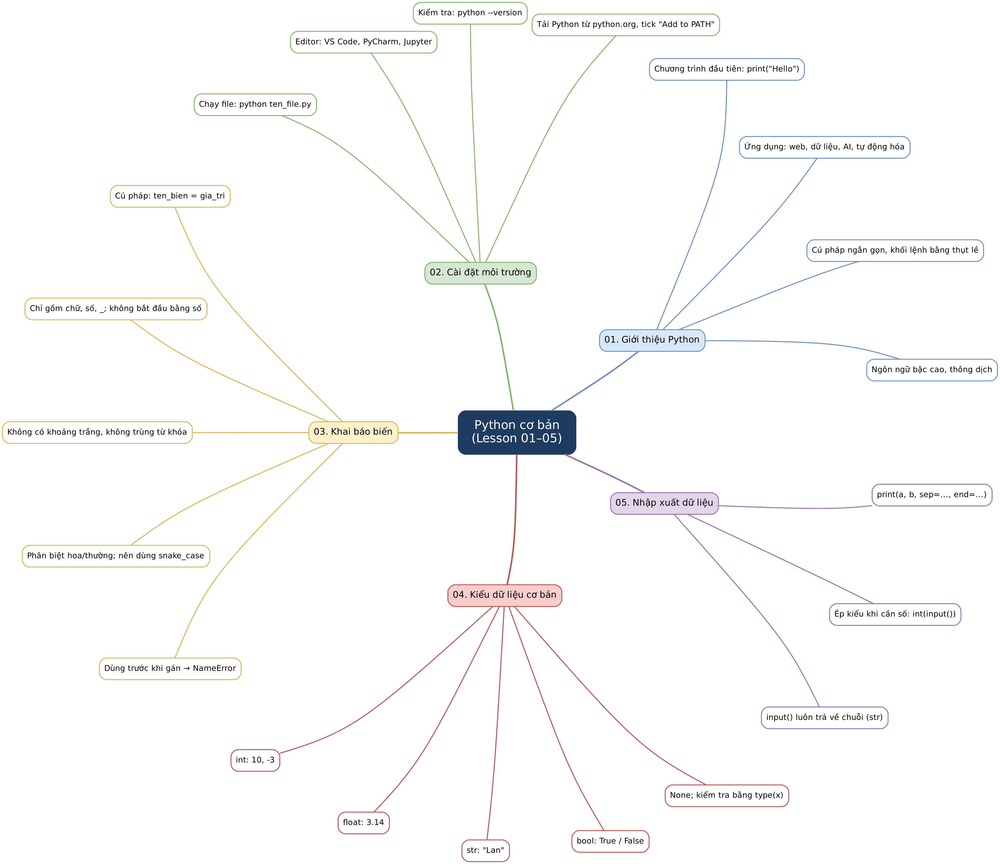

# Mindmap Python cơ bản (Lesson 01–05)

Sơ đồ tư duy tổng hợp kiến thức 5 bài đầu của khóa Python: giới thiệu ngôn ngữ, cài đặt môi trường, khai báo biến, kiểu dữ liệu cơ bản và nhập xuất dữ liệu.

🔗 **Link mindmap (draw.io):** [Mở mindmap trên draw.io](https://www.draw.io/#R3ZzZbuM2FIafRkByMQEXrZeSncy0Mw0CzKC9NGSJsYTIkivLWfr05aLVpKdFLbKwcxGYlLWY%2FPzr%2FOdQtvBi%2B%2F6cF8TC9xZepHm8qeOthUAZb2nf0kLo6aPJqpJ2JRX9t47pSyTevX3%2FXMe77LcqJYXoqauq6bYtSFHQHfJUHAaw3dDDia2QbwW7uCZl82924Gfi%2B7zGxUG6VGvhWiFk12vdQysKrRDTfregx47WNX21Ya9uvpH9nu8AoHWPLB9YAQbOrTjwvvkoSHe2Q5kSdmpId3vL8oZ838UJ2%2FpGh4D2Zc22aDfT4SwWVVHVfF8Mn3HsPLP%2BqmxG%2Fc%2F8j%2Fbvm7p6Iaf2%2BJ7%2FxU5Dh6Ntt1fFztQOAKkb8n5yHOF4vki1JU39Qd%2FS7uA5rtjlQ7RdzxfttzxtMtGHgCP6MpJvsvawHhJ98V60N%2F2hh1mjL9qJU09iAaQpBPCOdnzO%2BbRFVhDltNlkXdv3DrTdzfOMs5TGxH9OVLPhJj5ZH80GdPTMRhCAyWw4NpZmA%2FqK2cDu%2BbNBuukYDSkp07CuqzfaKquSdkbJoX7tx%2Fj0YIktf7SXjfvhIemG%2FHxw6PmrQ52Q4%2B95E9cb0ozBkYexJkXc5K%2FTM5xH6Epm9HFjLbAV2Uw4yk1LZvgwVptlwlQopoq54Py2O2xoI%2B1QjpJsVoRPC4oSYTwPstDG9pTZAMkKgjxtzK60UYv%2BM7XdN2nK7MogtVCidsEZDNnFcxxDuBv4pcg%2BMJw7mv1lKdB9yTolhkyJi16Hy2zEewQ52k335tBpxm%2BG18A5xs6EcxzYEucYYH2cw4vhHJrjHEmcdwj6E7UNHdrEjP43shZop2PlLiYRBtsc%2FtKKd7shYuGktbDpN6H7SgT8FELccXwNkFNaJ5D37bGYBxohRxcDOTIHOZbFPGMOJwLC5wjxrbmqL7gwjzil0s6D5ibn28NSfA12dV42N9QJ%2FXlgni36Qs9aDc3ba6AZeFOaAwXMrsbIBF8MzNgUzHJcAhBzfDw6CUF%2BzG7ksUhiK%2BLnvMWck99q8JLBP6cRdIif2qq58NEau64ZI%2BgBOCHXxnJQDQNtRvD8UKMfLM1G0FioARVG8EefXMpHWYk%2BYggj9rF4711Vb9pwIk9eGOS90oZpyrpZcu0p%2FPFl2GBIgZVYz6TAvhdMMIaBHDJ3R9VA8QzW8ATHZwgwVFFszhpChTX82ge%2FeMslNm5jhI7oT58oBvt85pzb%2F8Ok66MJk0AhrIE%2BJOHFIGlQWmUXd5%2FmDfvADMPfv7MAgVYZhII%2BfSyyuN6Kxq8HCimpr4BLu8u8d7d8RSLewfrARBcDJjIHptJ5tTd9yE4qamcTsWxIuWLdd7uPK8ASwymW0FGkd6FGLvHFcGnMRMlyCTAzUV%2BzOOdZWZ7e5eXavPNRD7Pfu1GirJel7tp1DNkkB0zhdANXvps7vi44z5fMfrA02yRjkokUNklVeeCSyZRynRMmmvydYJPHq6bODcmmktS5ck9HzgcDW1FX1xZnohmszwk2z5BNpCLTnPVBqqpYV7Lyg1H5K%2BA%2BKMlGFQIWbO77Wphor%2FhQsBrZUN7tS8APjToPe1QzGx%2Fz4qnH3jSE7T7U2O9DpA96eDHQQ3PQy9HC1zGwiShfcY6rYbVUW1Loi8Obvh487CpKDpEog02yXi%2BGi2I6oQb%2FGGJg5OhjGl0M0waDDNmXPYnQApVD1MuKuUyEs4pi%2BNBkcuGAy3fZ1cVYSXjgeV%2FGL2SVxHtyDcJ8VAgD0GQiFs1g4kxBbM7ErWwJ4uVYT48KXVHCdTXnYQqPonnczJatuhZbcwUe6Zrdezqm9TXEz%2B60AAaBr8iH2Rp1174YZG1TyMqqC2yedxjqB4efL6w5tTJ7Tl79hKgzE2vfsR1gqICLp%2F4v6NYZmKkznK%2B3%2FWBpzkwY01usyEzk7HpZJgICEd5%2Bwoa0U8nibC7sqOqKbPl2H2i72%2BMZcg8n6DtDOrGKPXO5B6zIPTwXVdzyh%2B%2BgfQXkOc40AQCxLae99C1bwTMkAEyRB82RJycA6GcT3A2rTb6xB7sMLz3RiaLnoiMUA7nS7%2Bu7Ac%2Fg202hiMyhKEeQ66oqBIs%2FatrHkGRh40NcGDPeOjEMbOcIQ8%2BRA0Hs6%2BMQXwyHBkNB2Xo%2FipFgHlteDSU%2F6fKxIzfvt1cAKATBcbQYBIoKv8abtn0xhBpz2jKfwGFO%2B7FffbJkT2%2B9H7omf%2BDqJ8Z7Rk4JpGukPdU0UJOLY0OlfwjAlFsf2opnZbXd4M%2BHth8tzQ7bHLRKh707NDe3jMfD8NTsUFhidafX0XOCtOh66DKeHst13tDRMaWzSn5ne7TKOdJZ6AHFg7JAG7Az2PITyJ6hs7YKWHO23FbYcoapH%2BymkcChT74nfTW%2FnJbveRDLHqpqmb8KarE3tVFBoEjDI18ftPBioIXmoJUdvXicLxZZzPYB1z2hSC3v7u5Ek46baF4FmLY9LWn6AJhcYGXP4O9NganJ39Pm8Hs%2FfNvxzwHRzu4XhYY3tb829Dc%3D)



## Tóm tắt kiến thức

### Lesson 01: Giới thiệu ngôn ngữ Python
- Python là ngôn ngữ bậc cao, thông dịch (chạy từng dòng, không cần biên dịch trước).
- Cú pháp ngắn gọn, dễ đọc; khối lệnh được xác định bằng **thụt lề** thay vì dấu `{}`.
- Ứng dụng rộng: web, phân tích dữ liệu, AI/Machine Learning, tự động hóa.

```python
print("Hello, World!")
```

### Lesson 02: Cài đặt môi trường
- Tải Python tại python.org, khi cài nhớ tick **Add Python to PATH**.
- Kiểm tra cài đặt: `python --version`.
- Công cụ viết code: VS Code, PyCharm, Jupyter Notebook.
- Chạy chương trình: `python ten_file.py`.

### Lesson 03: Khai báo biến
- Cú pháp: `ten_bien = gia_tri`. Python tự xác định kiểu (kiểu động).
- Quy tắc đặt tên:
  - Chỉ gồm chữ cái, chữ số và `_`; **không bắt đầu bằng số**.
  - **Không chứa khoảng trắng** (`student name` → lỗi, dùng `student_name`).
  - Không trùng từ khóa (`if`, `for`, `class`…); phân biệt chữ hoa/thường.
- Dùng biến trước khi gán giá trị → `NameError`.

```python
student_name = "Lan"
score = 10
print(student_name, score)
```

### Lesson 04: Kiểu dữ liệu cơ bản

| Kiểu | Ý nghĩa | Ví dụ |
|---|---|---|
| `int` | Số nguyên | `10`, `-3` |
| `float` | Số thực | `3.14` |
| `str` | Chuỗi | `"Lan"` |
| `bool` | Đúng/sai | `True`, `False` |
| `NoneType` | Không có giá trị | `None` |

Dùng `type(x)` để kiểm tra kiểu của biến.

### Lesson 05: Nhập xuất dữ liệu
- `input()` luôn trả về **chuỗi**, muốn tính toán phải ép kiểu: `int(input())`, `float(input())`.
- `print()` có tham số `sep` (ký tự ngăn cách) và `end` (ký tự kết thúc dòng).

```python
name = input("Nhập tên: ")
age = int(input("Nhập tuổi: "))
print("Tên:", name, "- Tuổi:", age, sep=" ", end="\n")
```
